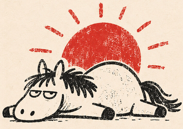
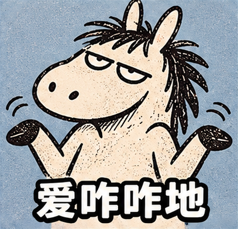
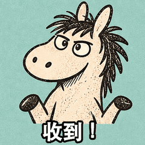
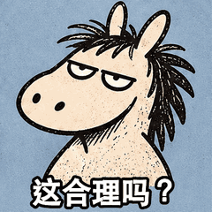
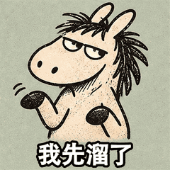
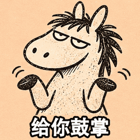
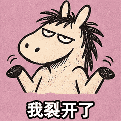

# dy-gif-motion-quality

一个制作、诊断和压缩动画 GIF 的 Agent Skill。适合手绘表情包、短动作和循环演示。它指导 Agent 先设计关键姿势与停顿，再检查角色一致性、循环接缝和导出画质。

## 安装与使用

在支持安装 Skill 的 Agent 里，直接发送这句话。Agent 可以按当前环境的方式安装。

```text
帮我安装 cxcxy/dy-gif-motion-quality 这个 Skill。
```

安装后，把你的角色原图或参考素材发给 Agent，再告诉它想做的动作和配文。例如：

```text
用 dy-gif-motion-quality，把我附上的小驴参考图做成「给你鼓掌」GIF。
保留手绘质感和小驴的脸型、耳朵、鬃毛。让它连拍两下，底部加白字黑边配文。
再导出一份适合聊天发送的轻量版，保留动作节奏和循环。
```

## 小驴原图与制作素材

| 角色原图 | 这 5 张 GIF 实际用的参考图 |
| :---: | :---: |
|  |  |

左图是最早提供的角色原图。右图是从后来提供的手绘九宫格里裁出的「爱咋咋地」，用来参考小驴的长脸、长耳、乱黑鬃毛和纸张印刷质感。

每张新表情先按自己的动作画出 9 个姿势，再排上固定的白字黑边配文。比如「给你鼓掌」画出了蹄子分开、靠近、接触、再分开的过程，「这合理吗？」靠挑眉、侧眼和停顿传达怀疑。

续做同款时，可以让 Agent 读取 [手绘小驴风格](references/hand-drawn-donkey.md)，里面记录了角色特征、线条和配色、文字位置，以及几种典型动作的节奏。

## 小驴 GIF 演示

| 收到！ | 这合理吗？ | 我先溜了 |
| :---: | :---: | :---: |
|  |  |  |

| 给你鼓掌 | 我裂开了 |
| :---: | :---: |
|  |  |

仓库里的五张是 240 × 240 像素的轻量版，每张约 198–244 KB。相比对应的 400 × 400 像素原版，整套 ZIP 从约 4.9 MB 降到 1.1 MB，缩小约 77%。五张均保留 9 个动作画面、原来的逐帧延时和无限循环。

## Skill 文件与检查脚本

制作从 [SKILL.md](SKILL.md) 开始。需要压缩现有 GIF 时，参考 [编码与验收](references/export-and-review.md#聊天表情的轻量版)。本地检查脚本需要 ImageMagick 7，可以读取画布、逐帧延时、循环和体积。

```bash
bash scripts/inspect-gif.sh examples/04-applause.gif
```
